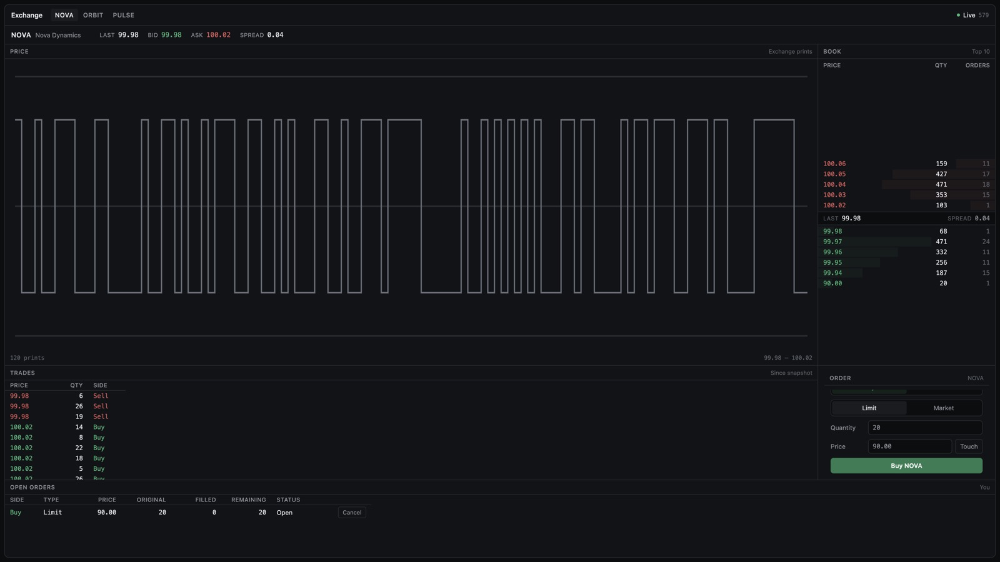

# exchange-sim

A simulated continuous limit-order book for three fictional securities, NOVA, ORBIT
and PULSE. Prices are not fetched from anywhere. They are the trades produced when
orders match inside this process. The claim the rest of the system exists to make
checkable is: given the same sequenced command stream, the engine produces the same
trades and the same final book.



The screen above is the live exchange. The chart is a step line of prints from that
session, not an outside price series.

---

## Run it

Go 1.24 or later, and Node.js 20. From the repository root, one terminal:

```sh
make dev
```

Then open `http://127.0.0.1:5173`. Ctrl-C stops both processes. `make dev` installs
frontend dependencies only when `frontend/node_modules` is missing, starts the
exchange with bots on, and starts the Vite dev server. The dev server proxies `/api`
and `/ws` to `127.0.0.1:8080`, so the browser has one origin and never sends a
participant id.

The same two processes, if you want a log each:

```sh
# terminal 1
cd backend
go run ./cmd/exchanged -addr 127.0.0.1:8080 -session-dir sessions -bots=true

# terminal 2
cd frontend
npm install
npm run dev -- --host 127.0.0.1 --port 5173
```

Session logs are `backend/sessions/session-<SYMBOL>.ndjson`. They are gitignored.

---

## A 30–60 second demo

Nothing on the screen is scripted. Every print comes from the matching engine.

1. Open the screen. NOVA's book, tape and chart move on their own: two bots are
   submitting through the same command path as the form.
2. Click ORBIT, then PULSE. Each market has its own book and its own price. Come
   back to NOVA.
3. Read the best ask and the quantity at that price.
4. Leave the form on Buy and Limit. Set the quantity **larger than that ask size**.
   Click Touch, which fills the current ask into the price field, and submit.
   The order trades what is offered at that price and rests the rest. Open orders
   shows side, limit, original, filled, remaining and Partial.
5. Leave it. Bots sell into the new best bid. Filled climbs and remaining falls
   with no refresh: those updates are `order` events on the WebSocket.
6. Cancel. The row disappears. The server no longer lists the order.
7. Switch to Market. Set the quantity **larger than the top ask** (the book shows
   the size) and buy. The order lifts that level and the next one, the tape prints
   both prices, the chart and the book move, and nothing rests. A market quantity
   smaller than the top level prints only one price.
8. Stop the exchange and replay the log it just wrote. Two independent replays of
   that file must agree:

```sh
cd backend
go run ./cmd/replay -file sessions/session-NOVA.ndjson
```

The last line is `determinism    ok (two independent replays agree)`.

A seeded run does not need the UI. The same seed and tick count produce the same
digest, and replaying the log reproduces it:

```sh
cd backend
go run ./cmd/simulate -ticks 200 -seed 7 -session-dir /tmp/exsim
```

On this machine that command prints live and replay digests
`53ee0528ad6a11af70976ca56c9647e6004e2de04e867a5ef0fc19255410ae65`, and a second run
with the same flags prints the same digest.

---

## Architecture

```text
                      React client
                   order form    screen
                       |            ^
                 HTTP commands      | WebSocket
                       v            |
                     Go API         |
                       |            |
                       v            |
                 Market actor  -----+--- immutable events
              one goroutine owns    |
              the book for a symbol |
                       |            v
         +-------------+------------+      market-data hub
         |             |            |      one bounded queue per subscriber
         v             v            v      a full queue drops that client
   matching      command log      bots    it never waits, so a slow browser
   engine /      (NDJSON) and     via     cannot stall matching
   order book    replay           the
                                  same
                                  command
                                  path
```

Reads (`Snapshot`, open orders, digest) are closures run on that same goroutine.
Callers receive copies. `Sink.Publish` runs on the matching path and is not allowed
to block; the hub's publish is a non-blocking send.

---

## Prices and orders

Prices are `PriceTicks int64`. With a one-cent tick, `$100.10` is `10010`. Decimal
money is not exact in `float64`, and a level map is keyed on price equality, so the
matching path never uses a float. Ticks become a decimal string only at the edge:
`internal/display`, `instrument.Format`, and the React client.

Two order types:

- A **limit** order matches while the opposite best price is acceptable, then rests
  at its limit with whatever is left.
- A **market** order matches until it is filled or the opposite side is empty. Any
  remainder is canceled. A resting order with no price would have no place in the book.

Better price first. Within one price, earlier acceptance first. Priority is the
market sequence assigned when the order was accepted. Orders have no timestamp, so
matching cannot depend on a clock.

A trade prints at the **resting** order's limit. The resting order published that
price first. Cancel of an unknown, filled, or already-canceled order is
`ErrUnknownOrder`: the book only knows live orders.

The human identity is assigned by the server (`human`). The HTTP body has no
participant field, and unknown fields are rejected. Cancel still checks ownership,
so the browser cannot pull a bot's quote.

---

## The book

Each side is a price map, a price heap (max for bids, min for asks), and a
doubly-linked FIFO queue per level with a running quantity. One book-wide
`map[OrderID]*locator` makes cancel an unlink rather than a search.

| Operation | Served by |
| --- | --- |
| Best price | heap root |
| Insert at a price | level map |
| Oldest order at a price | FIFO head |
| Cancel by id | order index → locator → unlink |

A level that drains stays in the map and the heap until it surfaces at the root,
where both copies are dropped. That keeps the heap's price set equal to the map's
keys without a third membership structure. When drained levels outnumber live ones
the heap is rebuilt. The rebuild can reorder the backing array. It cannot change
which price is best: the root of a heap is the unique extreme, and every ordered
walk sorts explicitly instead of reading heap order. The bound and the argument are
in [`docs/order-book-internals.md`](docs/order-book-internals.md).

---

## One writer

Concurrent HTTP handlers, WebSocket writers and bot goroutines are useful.
Concurrent mutation of one book is not: the trades would depend on the scheduler,
and the matching path would carry locks. Every command for a symbol goes through
one channel. One goroutine drains it, assigns the next sequence, appends the
command to the log, then matches.

Whichever command the actor dequeues first gets the lower sequence and the better
time priority. No participant timestamp is consulted. Bots use `TryEnqueue` and
back off when the queue is full, rather than blocking the actor. A query whose
caller has given up still runs; its result comes back on a buffered channel, so an
abandoned read cannot race the caller. `TestAbandonedQueriesDoNotRace` is the
regression test.

---

## Replay

Every accepted or rejected command is appended before it executes:

```json
{"seq":7,"cmd":{"kind":"submit_limit","participant":"human","side":"buy","qty":50,"price":10010}}
```

Replaying that file into a fresh engine reproduces the trades, the resting orders
in the same FIFO positions, and the final sequence. Four decisions make that true:

1. Order ids come from a counter, so a recorded cancel still names the same order.
2. Rejected commands are logged and consume a sequence. Skipping them would mint
   different ids afterwards.
3. Validation is a pure function of the command.
4. The write path does not read a wall clock.

A gap, a duplicate or a reorder in the log is an error. A prefix of a log is an
earlier moment in the session and replays. If the append itself fails, the market
halts without consuming the sequence, so the file still describes the state it
stopped in.

This is not crash-safe. Records are flushed, not fsynced, and a torn last line is
not detected. It is a replay log, not a write-ahead log.

Two different reproducibility claims, and they are not the same:

| Runner | Reproducible from | Why |
| --- | --- | --- |
| `sim.Driver` (`-mode deterministic`) | its seeds | One goroutine polls the bots in a fixed order. Scheduling never enters the stream. |
| `sim.Live` (`-mode live`, and the server) | its recorded log | Bot goroutines race. Which command arrives first is the scheduler's choice. |

The actor's job is to turn that arrival race into one total order. After that
order exists, execution is deterministic. A test of sixteen goroutines checks that
the sequences are the dense range `1..N` and that replaying the captured log
reproduces that run. It does not assert an order between the goroutines.

The digest is SHA-256 over the canonical book: every level, every resting order's
id, owner, priority and quantities, and the whole trade history. Two markets can
share a top-of-book snapshot and still disagree about who is next in line. They
cannot share this digest unless they are the same book.

---

## Real-time feed

Commands enter over HTTP. Market data leaves over a WebSocket. The protocol is in
[`docs/protocol.md`](docs/protocol.md).

Live messages are incremental. Each command records the price levels it touched,
and the update carries those levels, the trades it printed, and the new quotes.
Level quantities are absolute, so applying the same level twice does not
double-count a fill. Trades are not like that: each trade is one execution, and
applying it again would print it twice. Order lifecycle events are a complete view
of that order (original, cumulative filled, leaves, status). Status is derived
from the quantities: `open`, `partially_filled`, `filled`, `canceled`.

A subscriber sees lifecycle events only for `human`. Bot orders stay off that stream.

The snapshot and the subscription have to describe the same moment:

```text
1. subscribe                 the hub queues from here; nothing in between is missed
2. read book + own orders    one query on the market goroutine, both at sequence S
3. send that pair as the snapshot
4. forward the queue,        seq <= S is already inside the snapshot
   dropping seq <= S
5. continue live
```

Several messages share one sequence, because one command produces an order event
and a book update. The client drops `seq <= S`, not "anything at or below the last
sequence I saw", or it would discard the sibling. On a resync frame or a dropped
socket the client throws away its book, tape and working orders and waits for the
next snapshot. It does not replay a gap.

---

## Simulated traders

Two bots in `internal/sim`. They are decision functions: a `Bot` receives an
immutable view and returns commands. It does not hold the book. Both the
deterministic runner and the live runner submit those commands through the actor,
and both refuse a command whose participant is not the bot.

The view shows the bot its own orders and an aggregated book with no order ids, so
naming someone else's order is not expressible. The market also rejects a cancel
from the wrong owner.

The market maker quotes a ladder around a reference price and shifts the ladder
instead of crossing, which is what keeps it from trading with itself. There is no
self-trade prevention in the engine. The noise trader draws from a seeded PRNG:
mostly aggressive orders, sometimes a passive order, occasionally a cancel. The
reference price is read from the book (mid, else last trade, else a side, else the
instrument's bootstrap price). It is never written into the last price. The last
price moves only when a trade prints.

A cancel that misses because the order was filled a moment earlier is expected. A
malformed command is a bug. `TestBotCommandsAreAlwaysValid` draws that line.

---

## Tests

```sh
cd backend && go test ./...          # 127 test functions, 60 subtests
cd backend && go test -race ./...
cd frontend && npm test              # 17 tests, state and order payloads
make test                            # both
```

The engine harness runs the invariant check after every command in a test, not
only at the end. A corrupt index usually survives the command that caused it and
shows up later.

`CheckSemanticInvariants` is what any correct continuous book owes, regardless of
representation: no crossed book, resting quantity above zero, quantity conserved
(`original = filled + remaining + canceled`), truthful level totals, strict FIFO
sequences, live orders addressable and only live orders addressable, an order
resting on the side and price it asked for, market orders never resting.
`CheckImplementationInvariants` is specific to this design: heap keys equal map
keys, locators point at the right node, FIFO links agree, cached counters match.
`TestInvariantClassesCatchDifferentFaults` corrupts one class at a time and checks
the other does not spuriously fail.

Around that: worked examples (sweeps, FIFO, price over time, the one-tick boundary,
market remainders), malformed commands that are rejected and still consume a
sequence, seeded random streams with global quantity conservation, replay digests
including a test that a different order produces a different digest, bot ownership
and the maker's refusal to take liquidity, HTTP and WebSocket behaviour, passive
fills delivered to the human stream, and the subscribe-then-snapshot boundary
under concurrent trading.

The race detector reports races that the run actually hit. A clean run is evidence,
not a proof that no race exists.

Frontend tests cover the state transitions that drift quietly: installing a
snapshot, writing absolute level quantities, a passive partial fill, terminal
filled and canceled orders, ignoring a stale lifecycle sequence, a resync
replacing client state, and limit versus market request bodies with no participant
field.

---

## Benchmarks

Engine only. No actor, no journal, no HTTP, no WebSocket, no UI. Do not read them
as exchange throughput.

Measured with:

```sh
cd backend
go test ./internal/engine/ -run '^$' -bench . -benchmem -count=1
```

Apple M3, 8 cores, 16 GB, darwin/arm64, macOS 26.6.2, Go 1.27.1. Default bench
time, one count. `go test` reported `cpu: Apple M3`.

Depth is held constant, and each case pairs an operation with its inverse so the
book does not drift. The `ns/op` is the cost of the pair. The question is how that
cost moves as the book gets deeper.

| | 1k resting | 10k resting | 100k resting |
| --- | ---: | ---: | ---: |
| insert + cancel | 144 ns | 175 ns | 205 ns |
| resting order + the fill that takes it | 204 ns | 246 ns | 274 ns |
| read best bid and best ask | 9.8 ns | 9.7 ns | 9.8 ns |

Best-price reads allocate nothing. A hundred times the depth costs well under twice
the mutation time. That is the property the order index and the lazy stale-level
scheme are there to protect.

Snapshots sort every live level and keep ten. Deltas report the levels the command
touched. The delta figures include the two submits that produced the change.

| | 20 levels | 200 levels | 2000 levels |
| --- | ---: | ---: | ---: |
| full snapshot, top 10 per side | 528 ns | 6.48 µs | 135 µs |
| incremental update | 320 ns | 293 ns | 344 ns |

An earlier run on this machine measured the 2,000-level incremental path at
1,119 ns while a swept command's touched-set was retained, and about 325 ns after
oversized maps were dropped. This run measures 344 ns. `clear` on a Go map costs
the bucket count, and maps do not shrink, so one wide sweep was taxing every later
one-level command. `TestTouchedSetIsNotRetainedAfterALargeSweep` locks the fix.

These time a single shape of work. The book under them is not the same size, so
**they are not subtractable**. `SubmitAndCancel` is faster per command than a
passive insert because it pulls every order back out, while the passive benchmark
finishes with millions resting.

| Benchmark | ns/op | B/op | allocs/op | what the unit includes |
| --- | ---: | ---: | ---: | --- |
| Submit passiveLimit | 269 | 210 | 3 | one resting insert; book grows without bound |
| SubmitAndCancel | 166 | 215 | 5 | insert and cancel; book stays empty |
| MatchOneLevel | 182 | 432 | 6 | one fill, 1.00 trades/op |
| SweepTenLevels | 2589 | 8400 | 68 | 10.00 levels/op |
| MixedFlow | 266 | 353 | 3 | 0.730 trades/op |
| LargeWorkload | 22.2 ms | — | — | 100,000 commands, 4.50M commands/sec reported |

`BenchmarkLargeWorkload` is one synthetic stream, on one core, with no sequencing,
no journal, no events and no network, against a book of a few dozen prices. It is
a floor on the matching core. It is not a measurement of the exchange.

---

## Limitations

This is an educational simulated exchange. It is not a brokerage and not a
production trading system.

- No real-money trading, no customer accounts, no cash or share balances, and no
  pre-trade risk checks.
- No external market prices, and no brokerage, FIX, auction, regulatory, routing
  or market-data protocols.
- No authentication. One server-assigned participant, `human`.
- Order types are limit and market, plus cancel. No stop, iceberg, IOC, FOK, or
  cancel/replace. There is no auction.
- The session log is not a crash-safe write-ahead log: flush without fsync, no
  torn-write detection, no checkpoint.
- A client that falls behind is told to resync. There is no gap replay.
- Publishing a full book snapshot gets expensive as the number of distinct prices
  grows. Snapshots are the synchronisation path, not the live path, and top-K
  selection is still a full sort of the live levels.
- Every trade of the session is kept in memory so the digest can cover the whole
  history.
- No self-trade prevention. The market maker avoids crossing its own quotes; the
  engine would not stop it.
- The bots are a way to make the book move. The price path is not a market model,
  and nothing here is a latency claim about a real venue.

---

## Layout

```text
backend/cmd/exchanged     HTTP, WebSocket, bots
backend/cmd/simulate      seeded or live bots, then a replay check
backend/cmd/session       scripted human session, then a replay check
backend/cmd/replay        rebuild a market from a session log
backend/internal/engine   book and matching, no I/O
backend/internal/market   sequence, log, actor, replay
backend/internal/sim      the two bots and both runners
backend/internal/feed     hub and wire messages
backend/internal/api      HTTP and WebSocket handlers
frontend/                 React screen; renders the feed, does not price it
docs/protocol.md          the wire protocol and the sync steps
docs/order-book-internals.md
scripts/dev.sh            what `make dev` runs
```

`make test`, `make test-race` and `make bench` are the checks above.
